# Tugas Rutin 11 - E-Commerce DB dan Secure Auth

**Nama:** Maulana Akbar Said Hasugian
**NIM:** 4252550012
**Mata Kuliah:** Pemrograman Web

## Deskripsi

Project Laravel dengan dua bagian:

- **Bagian A:** database e-commerce (migration, factory, seeder, model, relasi, scope) dan dokumentasi lima query Tinker.
- **Bagian B:** autentikasi dengan Laravel Breeze, multi-role (admin, editor, user) lewat custom middleware, dan otorisasi dengan `PostPolicy`.

## Cara Menjalankan

1. Salin repository ini, lalu masuk ke foldernya.
2. Jalankan `composer install`.
3. Salin `.env.example` menjadi `.env`, lalu atur koneksi database (`DB_DATABASE=ecommerceauth_db`).
4. Buat database `ecommerceauth_db` di MySQL.
5. Jalankan `php artisan key:generate`.
6. Jalankan `php artisan migrate:fresh --seed`.
7. Jalankan `npm install`, lalu `npm run build`.
8. Jalankan `php artisan serve`, lalu buka `http://127.0.0.1:8000`.

## Akun Uji

Seeder membuat tiga akun uji. Password semuanya `password`.

| Role | Email |
|---|---|
| admin | admin@example.com |
| editor | editor@example.com |
| user | user@example.com |

## Bagian A: Database dan Eloquent

### Tabel

Ada 8 tabel buatan sendiri (7 tabel e-commerce ditambah `posts` untuk `PostPolicy`):

| Tabel | Isi | Foreign key |
|---|---|---|
| users | akun, kolom `role` (admin/editor/user) | - |
| categories | kategori produk | - |
| products | produk (harga bertipe `decimal`) | `category_id`, `user_id` |
| orders | pesanan, kolom `status` | `user_id` |
| order_items | item pesanan (`quantity`, `price`) | `order_id`, `product_id` |
| tags | label produk | - |
| product_tag | tabel penghubung many-to-many | `product_id`, `tag_id` |
| posts | tulisan milik pengguna | `user_id` |

Aturan penghapusan: `cascadeOnDelete()` pada sebagian besar foreign key, dan `restrictOnDelete()` pada `order_items.product_id` agar produk yang sudah pernah dipesan tidak bisa dihapus.

### Relasi

- `Category` hasMany `Product`
- `Product` belongsTo `Category` dan `User`, belongsToMany `Tag`, hasMany `OrderItem`
- `Order` belongsTo `User`, hasMany `OrderItem` (relasi `items`)
- `OrderItem` belongsTo `Order` dan `Product`
- `Tag` belongsToMany `Product`
- `User` hasMany `Product`, `Order`, dan `Post`
- `Post` belongsTo `User`

### Scope

Pada model `Product`:

- `scopeActive` untuk produk yang aktif, dipakai sebagai `Product::active()`
- `scopeInStock` untuk produk yang stoknya lebih dari nol, dipakai sebagai `Product::inStock()`

### Data Seeder

Seeder menghasilkan 10 user, 6 kategori, **60 produk**, 5 tag, 25 pesanan, dan 10 post.

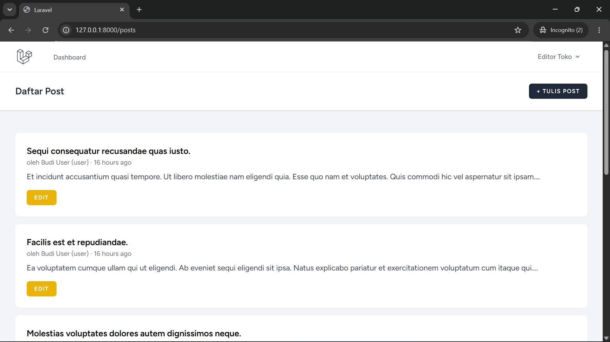

### Dokumentasi 5 Query Tinker

| No | Query | Yang dibuktikan |
|---|---|---|
| 1 | `Product::count()` | Jumlah produk (60) |
| 2 | `Product::with('category')->first(...)` | Relasi belongsTo dan eager loading |
| 3 | `User::where('email', 'user@example.com')->first()->orders->count()` | Relasi hasMany |
| 4 | `Order::withSum('items as total', 'price')->first()` | Agregat lewat relasi |
| 5 | `Product::active()->inStock()->count()` | Scope buatan sendiri |

Catatan: `withSum` pada query 4 menjumlahkan `price` tanpa dikali `quantity`, jadi hasilnya bukan total belanja sebenarnya.

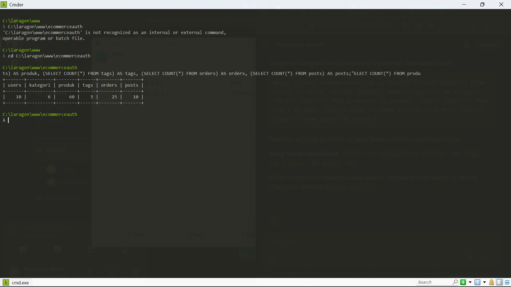
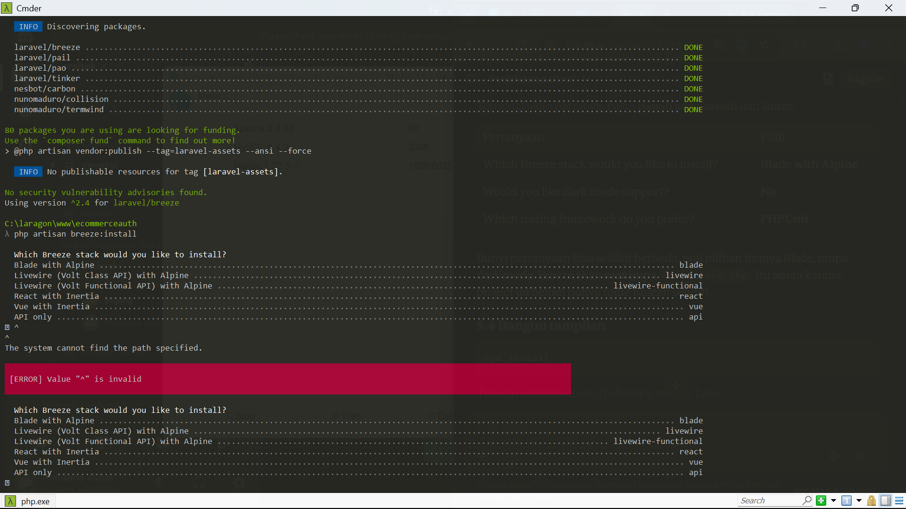
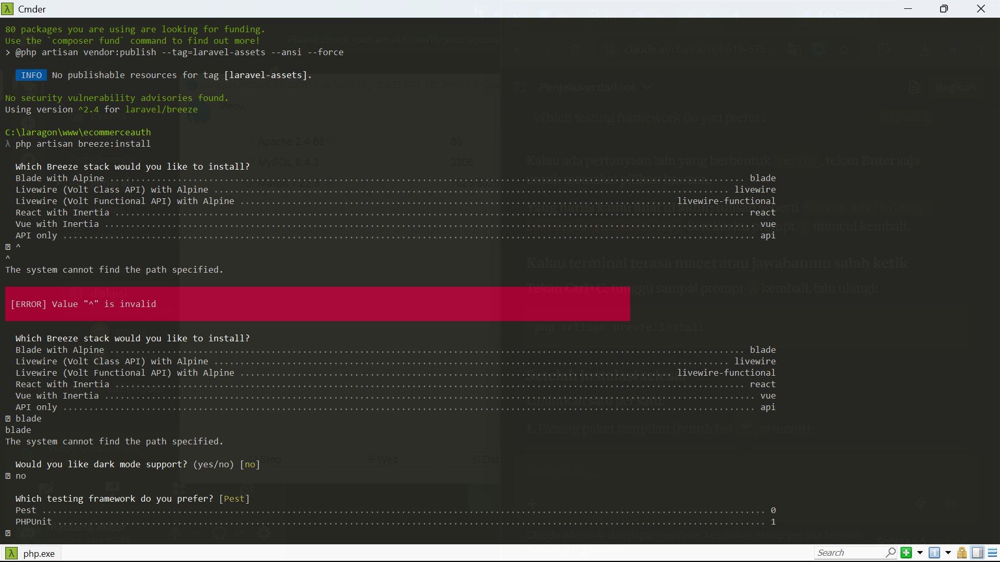
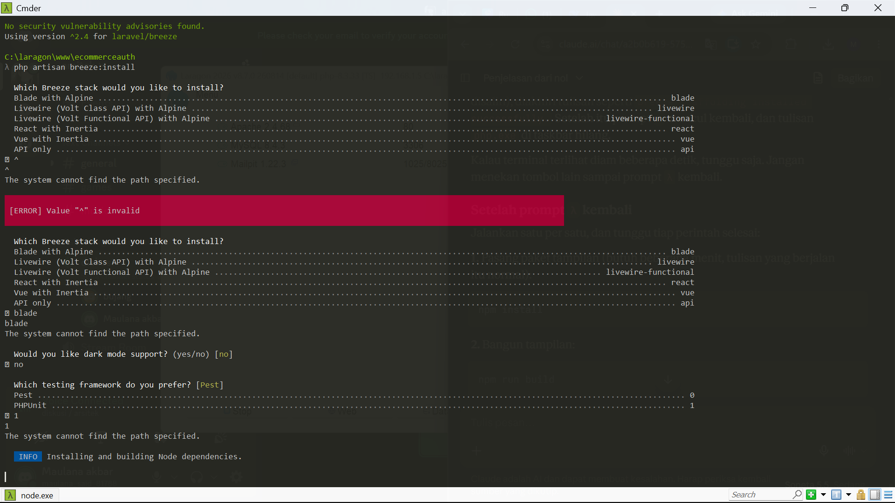
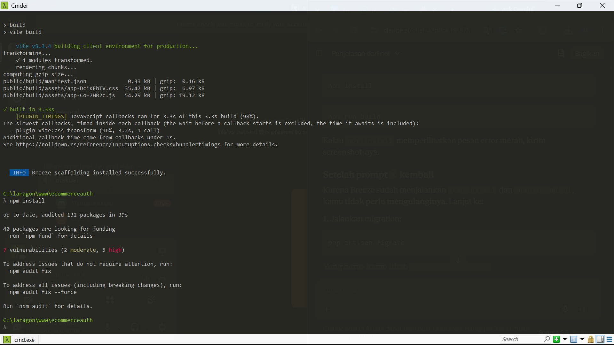

## Bagian B: Auth dan Security

### Breeze

Login, register, dan logout memakai Laravel Breeze (stack Blade dengan Alpine).

### Multi-Role dan Custom Middleware

- Kolom `role` pada tabel `users` bernilai `admin`, `editor`, atau `user` (nilai awal `user`).
- Middleware `CheckRole` (alias `role`) memeriksa role pengguna. Jika tidak cocok, responsnya **403 Forbidden**.
- Route yang dilindungi:

| URL | Middleware | Boleh dibuka oleh |
|---|---|---|
| `/admin` | `auth`, `role:admin` | admin |
| `/editor` | `auth`, `role:admin,editor` | admin, editor |
| `/posts` dan turunannya | `auth` | semua pengguna yang sudah login |

### PostPolicy

| Role | Edit post | Hapus post |
|---|---|---|
| user | hanya miliknya | hanya miliknya |
| editor | semua post | hanya miliknya |
| admin | semua post | semua post |

Policy dipanggil lewat `Gate::authorize(...)` di `PostController`, dan tombol Edit atau Hapus di tampilan dibatasi dengan `@can`.

### Hasil Pengujian (dua jendela, termasuk incognito)

| Akun | Halaman | Hasil |
|---|---|---|
| belum login | `/admin` | dialihkan ke halaman login |
| admin | `/admin` | tampil |
| editor | `/editor` | tampil |
| editor | `/admin` | 403 Forbidden |
| user | `/editor` | 403 Forbidden |
| user | `/posts/5/edit` (post milik editor) | 403 Forbidden |

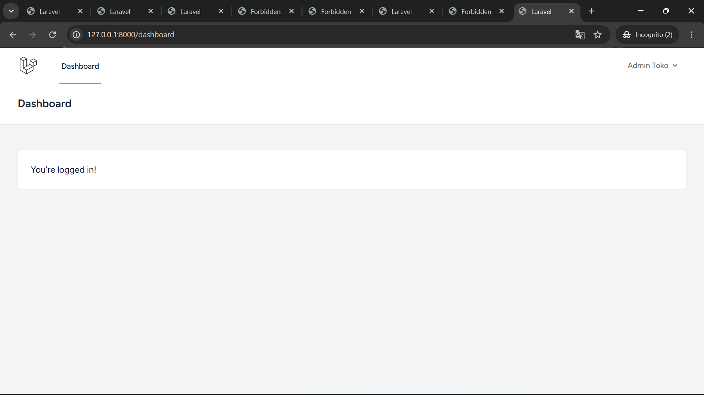
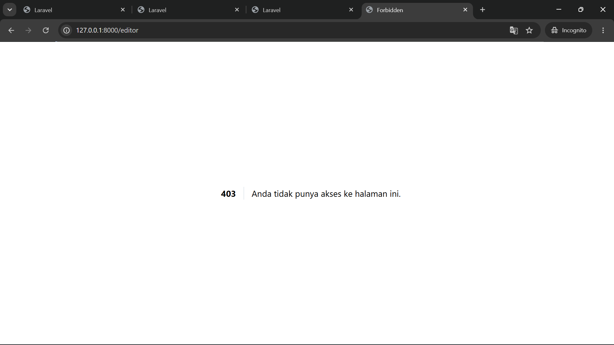
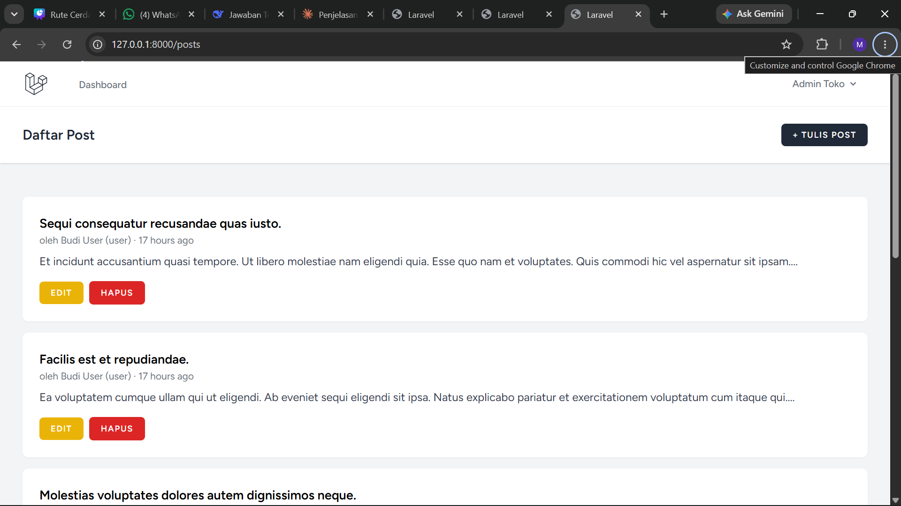
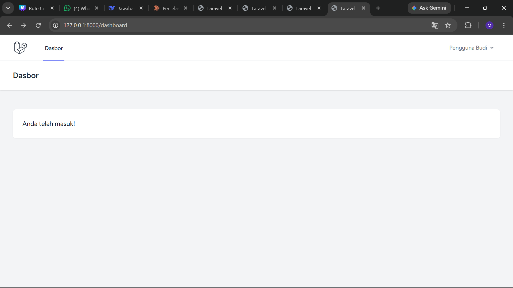
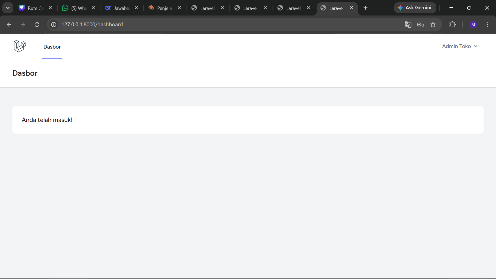